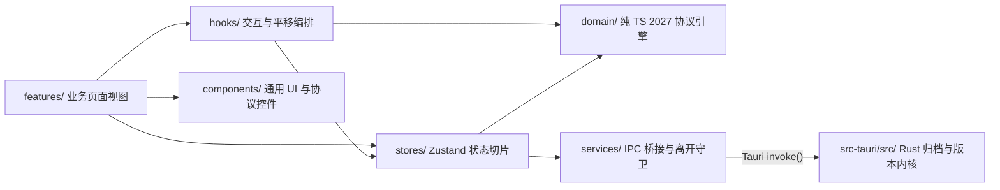

# 系统架构与目录树

MoKairos Studio 严格执行**页面展示与业务逻辑分离**、**桌面外壳与 1920×1080 协议画布分层**的六层架构。

## 总体分层与数据流



## 完整文件目录结构

```text
MoKairos_Studio/
├── AGENTS.md                               # 仓库总规范与 AI 阅读根入口
├── README.md                               # 仓库公开门面
├── doc/                                    # 【L1 全局公开文档：总-分专题】
│   ├── README.md                           # 总纲与各级文档索引
│   ├── architecture.md                     # 本文件：架构分层与目录树
│   ├── protocol.md                         # 2027 串口 UI 协议与视觉隔离规范
│   ├── mkui-format.md                      # .mkui (ZIP + MessagePack) 归档规范
│   ├── development.md                      # 开发命令、公共复用组件与编码约定
│   └── governance.md                       # 文档递推与审计规范
├── doc-project/                            # 【本地私有目录】(.gitignore 忽略) 背景、设计稿、规划与审计台账
├── src/                                    # 【L2 前端模块】
│   ├── AGENTS.md                           # 前端任务导航
│   ├── doc/                                # 前端总览 + domain / state / ui 分文档
│   ├── styles/                             # tokens.css (双主题+9色) & globals.css
│   ├── assets/rm-client-background.png     # 原生 1920×1080 官方底图（只作参考，不导出）
│   ├── domain/                             # 纯 TS 领域引擎（零 UI 依赖，Vitest 覆盖）
│   ├── stores/                             # Zustand 6 个状态切片
│   ├── services/                           # Tauri IPC、.mkui 读写、未保存守卫、背景亮度采样、最近工程
│   ├── hooks/                              # 视口缩放、指针捕获平移、快捷键、实时诊断、自适应玻璃反色
│   ├── components/                         # 公共复用组件（liquid-glass、toast、ContextMenu、Dialog 等）与协议控件
│   └── features/                           # 业务视图（shell、launchpad、editor、version-control、simulator、export-mock）
└── src-tauri/                              # 【L2 Rust 桌面宿主与归档内核】
    ├── AGENTS.md                           # Rust 任务导航
    ├── doc/                                # Rust 总览 + archive / commands 分文档
    └── src/                                # model / archive / versioning / protocol / commands
```

进一步阅读：[前端总览](../src/doc/README.md) · [Rust 总览](../src-tauri/doc/README.md) · [返回总纲](README.md)
